<picture>
  <source media="(prefers-color-scheme: dark)" srcset="assets/header-dark.svg">
  
</picture>

 

  <picture>
    <source media="(prefers-color-scheme: dark)" srcset="https://skillicons.dev/icons?i=go%2Cts%2Cjs%2Cpy%2Cbash%2Clinux%2Carch%2Cwindows%2Cgit%2Cgithubactions&theme=dark&perline=10">
    
  </picture>

### Проекты

**[Просвет](https://github.com/FrainTX/zapret)** — обход DPI для YouTube, Discord, Telegram, Rainbow Six Siege и For Honor.
Linux и Windows, автоподбор стратегий под провайдера, Telegram через WebSocket, игровой трафик мимо VPN, подписанные автообновления.
[Скачать](https://github.com/FrainTX/zapret/releases/latest)

 

<picture>
  <source media="(prefers-color-scheme: dark)" srcset="https://raw.githubusercontent.com/FrainTX/FrainTX/output/stats-dark.svg">
  
</picture>

<picture>
  <source media="(prefers-color-scheme: dark)" srcset="https://raw.githubusercontent.com/FrainTX/FrainTX/output/snake-dark.svg">
  
</picture>
